# Phần 1.1 – 1.3: Virtual Environment, Virtual Machine và Docker Container

## Mục tiêu
Hiểu rõ bản chất kỹ thuật, cơ chế cô lập (isolation), ưu/nhược điểm và trường hợp sử dụng của ba lớp công nghệ phổ biến trong phát triển và triển khai phần mềm:
1. **Virtual Environment** (Môi trường ảo cấp ứng dụng / ngôn ngữ)
2. **Virtual Machine – VM** (Máy ảo / Ảo hóa phần cứng)
3. **Container (Docker)** (Ảo hóa cấp hệ điều hành)

---

## 1. Virtual Environment (Môi trường ảo cấp ngôn ngữ)

### 1.1. Bài toán thực tế
Khi phát triển nhiều dự án Python trên cùng một máy:
- Dự án A cần `django==4.2` và `numpy==1.26`.
- Dự án B cần `django==5.1` và `numpy==2.1`.

Nếu cài đặt mọi gói vào thư mục `site-packages` toàn cục (global) của hệ điều hành, các phiên bản sẽ ghi đè lẫn nhau (**dependency conflict**). Tệ hơn, trên Linux, cài gói qua `pip` vào Python hệ thống có thể làm hỏng các công cụ của chính hệ điều hành (vì thế Ubuntu/Debian áp dụng PEP 668 `externally-managed-environment`).

### 1.2. Cơ chế hoạt động thực sự
Virtual Environment (như `venv` hay `virtualenv` trong Python) **không** tạo ra máy ảo hay nhân hệ điều hành mới. Về bản chất, nó chỉ là **một thư mục độc lập** chứa:
- Bản sao hoặc liên kết tượng trưng (`symlink`) tới trình thông dịch Python (`bin/python`).
- Thư mục `lib/pythonX.Y/site-packages/` riêng cho dự án.
- Tệp cấu hình `pyvenv.cfg` báo cho Python biết đường dẫn gốc (`home`) và không lấy gói toàn cục (`include-system-site-packages = false`).
- Script kích hoạt (`bin/activate`) làm hai việc chính:
  1. Đưa `<venv>/bin` lên **đầu** biến môi trường `PATH` của shell.
  2. Thiết lập biến `VIRTUAL_ENV`.

Khi Python khởi động từ `<venv>/bin/python`, nó tìm thấy `pyvenv.cfg` cạnh đó nên tự gán `sys.prefix` trỏ vào thư mục môi trường ảo thay vì `/usr`, từ đó `import` và `pip install` chỉ tác động trong thư mục này.

### 1.3. Đặc điểm
- **Mức độ cô lập:** Chỉ cô lập thư viện Python và một số biến môi trường shell.
- **Không cô lập:** Hệ điều hành, nhân Linux (kernel), thư viện C hệ thống (`libssl`, `glibc`, CUDA), tiến trình (`ps`), mạng/cổng (`localhost:8000`), hệ thống tệp (code vẫn đọc/ghi được file ngoài thư mục `.venv`).
- **Tốc độ & dung lượng:** Tạo trong < 1 giây, dung lượng ban đầu chỉ vài chục MB.

---

## 2. Virtual Machine (Máy ảo – Hardware Virtualization)

### 2.1. Khái niệm & Kiến trúc
**Virtual Machine (VM)** mô phỏng một máy tính vật lý hoàn chỉnh (CPU, RAM, ổ đĩa, card mạng, BIOS/UEFI) bằng phần mềm gọi là **Hypervisor**. Bên trong mỗi VM chạy một **Guest OS** hoàn chỉnh với **Kernel riêng**.

Kiến trúc phân tầng:
- **Type 1 Hypervisor (Bare-metal):** Chạy trực tiếp trên phần cứng vật lý không qua Host OS trung gian (ví dụ: **KVM** tích hợp trong nhân Linux, **VMware ESXi**, **Xen**, **Microsoft Hyper-V**). Hiệu năng rất cao, dùng trong Cloud/Server (AWS EC2, Google Compute Engine).
- **Type 2 Hypervisor (Hosted):** Chạy như một ứng dụng trên Host OS thông thường (ví dụ: **VirtualBox**, **VMware Workstation**, **QEMU** thuần phần mềm). Phù hợp cho học tập, thử nghiệm đa hệ điều hành trên máy cá nhân.

> **Lưu ý về QEMU + KVM trên Linux:** QEMU có thể giả lập CPU bằng phần mềm (TCG – chậm), nhưng khi kết hợp với module nhân **KVM (`/dev/kvm`)** và tập lệnh ảo hóa phần cứng (**Intel VT-x / AMD-V**), các lệnh CPU của Guest VM chạy trực tiếp trên CPU thật với hiệu năng gần như máy vật lý.

### 2.2. Đặc điểm
- **Mức độ cô lập:** Cực kỳ cao (cách ly hoàn toàn ở cấp phần cứng ảo và kernel). Mã độc trong Guest VM rất khó thoát ra Host OS.
- **Tính linh hoạt hệ điều hành:** Có thể chạy Windows trên máy chủ Linux, hoặc Ubuntu 22.04 trên macOS.
- **Nhược điểm:**
  - **Nặng tài nguyên:** Mỗi VM phải cấp phát RAM riêng, ổ đĩa ảo (`qcow2`, `vdi`, `vmdk`) thường tốn vài GB đến hàng chục GB cho cả Guest OS.
  - **Khởi động chậm:** Phải boot toàn bộ nhân OS và dịch vụ hệ thống (từ vài chục giây đến vài phút).

---

## 3. (Docker) Container (Ảo hóa cấp hệ điều hành)

### 3.1. Khái niệm
**Container** cô lập tiến trình ứng dụng ở cấp hệ điều hành: mỗi container có hệ thống tệp (rootfs), cây tiến trình, giao diện mạng và biến môi trường riêng, **nhưng dùng chung Linux Kernel với máy chủ Host**.

Docker là nền tảng phổ biến nhất để đóng gói, phân phối và vận hành container theo chuẩn OCI (Open Container Initiative).

### 3.2. Ba trụ cột công nghệ Linux tạo nên Container
Trên Linux, Docker không phải "phép màu" mà kết hợp 3 cơ chế có sẵn của nhân Linux:

1. **Linux Namespaces** – *Cô lập tầm nhìn (Isolation):*
   - `pid`: Container chỉ thấy tiến trình của chính nó (tiến trình chính bên trong có `PID = 1`, nhưng trên Host nó vẫn là một PID bình thường như `48210`).
   - `net`: Giao diện mạng, địa chỉ IP, bảng định tuyến, port riêng (nhờ đó chạy được nhiều container cùng lắng nghe port nội bộ `80` hay `5432`).
   - `mnt`: Cây thư mục riêng (mount point `/`, `/etc`, `/usr` từ Image).
   - `uts`: Hostname riêng cho từng container.
   - `ipc`, `user`, `cgroup`: Cô lập bộ nhớ chia sẻ, ánh xạ UID/GID và cây cgroup.

2. **Control Groups (`cgroups`)** – *Giới hạn tài nguyên (Resource Limiting):*
   - Ngăn một container chiếm hết RAM hoặc CPU của Host (ví dụ `--memory=512m --cpus=1.0`).

3. **Union File System (`overlay2`)** – *Tối ưu lưu trữ theo lớp (Layered FS):*
   - **Docker Image** được cấu thành từ nhiều lớp chỉ đọc (**Read-Only Layers**) xếp chồng lên nhau (mỗi lệnh `FROM`, `RUN`, `COPY` trong `Dockerfile` tạo một layer, có thể cache và dùng chung giữa nhiều image).
   - Khi khởi chạy **Container**, Docker gắn thêm một lớp mỏng có thể đọc-ghi (**Writable Container Layer**) lên trên cùng theo cơ chế **Copy-on-Write (CoW)**.

### 3.3. Kiến trúc Docker & Các khái niệm cốt lõi
- **Docker Client (`docker` CLI):** Nhận lệnh (`docker build`, `docker run`, `docker compose`) gửi qua REST API tới daemon.
- **Docker Daemon (`dockerd`):** Quản lý images, networks, volumes; điều phối vòng đời container thông qua **`containerd`** và OCI runtime **`runc`**.
- **`Dockerfile`:** Tệp kịch bản khai báo cách dựng một Docker Image.
- **Image vs Container:** Image là "bản thiết kế bất biến" (giống Class trong OOP); Container là "thực thể đang chạy" từ Image đó (giống Object).
- **Volume / Bind Mount:** Cơ chế lưu dữ liệu bền vững ngoài vòng đời container (cực kỳ quan trọng khi chạy database như PostgreSQL/MySQL trong Docker, vì xóa container sẽ mất dữ liệu ở writable layer).
- **Docker Compose (`docker-compose.yml`):** Công cụ định nghĩa và khởi chạy nhiều container phối hợp với nhau (ví dụ: Web App + Database + Redis) bằng một lệnh `docker compose up -d`.

---

## 4. So sánh Virtual Environment vs Container vs Virtual Machine

```mermaid
flowchart TB
    subgraph VE["1. Virtual Environment (venv / conda)"]
        VE_A["App A + Libs A (.venv)"]
        VE_B["App B + Libs B (.venv)"]
        VE_OS["Host OS + System Libs + Kernel"]
        VE_HW["Physical Hardware"]
        VE_A --> VE_OS
        VE_B --> VE_OS
        VE_OS --> VE_HW
    end

    subgraph DC["2. Docker Container"]
        DC_A["App A + Bins/Libs A (Container 1)"]
        DC_B["App B + Bins/Libs B (Container 2)"]
        DC_ENG["Docker Engine (containerd / runc)"]
        DC_OS["Host OS + Shared Linux Kernel"]
        DC_HW["Physical Hardware"]
        DC_A --> DC_ENG
        DC_B --> DC_ENG
        DC_ENG --> DC_OS
        DC_OS --> DC_HW
    end

    subgraph VM["3. Virtual Machine"]
        VM_A["App A + Bins/Libs A + Guest OS 1 (Kernel 1)"]
        VM_B["App B + Bins/Libs B + Guest OS 2 (Kernel 2)"]
        VM_HYP["Hypervisor (KVM / VirtualBox / ESXi)"]
        VM_HW["Host OS (nếu Type 2) + Physical Hardware"]
        VM_A --> VM_HYP
        VM_B --> VM_HYP
        VM_HYP --> VM_HW
    end
```

| Tiêu chí | Virtual Environment | Docker Container | Virtual Machine (VM) |
| :--- | :--- | :--- | :--- |
| **Mức độ cô lập** | Thấp (chỉ thư viện ngôn ngữ & `PATH`) | Cao (tiến trình, mạng, filesystem riêng) | Rất cao (phần cứng ảo & kernel riêng) |
| **Kernel** | Dùng chung Host Kernel | Dùng chung Host Kernel | Mỗi VM có Guest Kernel riêng |
| **Chạy khác OS?** | Không | Hạn chế (Container Linux cần Linux Kernel; trên Windows/macOS phải chạy qua VM ngầm như WSL2/LinuxKit) | Có (chạy Windows trên Linux và ngược lại) |
| **Thời gian khởi động** | Tức thì (< 0.1 giây) | Rất nhanh (vài trăm ms – vài giây) | Chậm (vài chục giây – vài phút) |
| **Dung lượng lưu trữ** | Nhẹ (vài chục – vài trăm MB) | Trung bình-Nhẹ (vài MB – vài trăm MB, chia sẻ layers) | Nặng (vài GB – hàng chục GB mỗi VM) |
| **Overhead CPU/RAM** | Gần như bằng 0 | Rất thấp (chỉ overhead tiến trình + cgroups) | Đáng kể (phải nuôi cả Guest OS) |
| **Quản lý gói hệ thống (`apt`, C libs)** | Không (trừ `conda` ở mức user-space) | Có (đóng gói toàn bộ userland OS) | Có (toàn quyền OS) |
| **Portability (tính di động)** | Trung bình (phụ thuộc OS & C libs máy đích) | Rất cao ("Build once, run anywhere" trên mọi Linux/Docker host) | Cao (xuất OVA/QCOW2 nhưng file rất lớn) |
| **Công cụ tiêu biểu** | `venv`, `virtualenv`, `uv`, `conda` | Docker, Podman, containerd | KVM/QEMU, VirtualBox, VMware, Hyper-V |
| **Khi nào nên dùng?** | Phát triển local nhanh cho 1 ngôn ngữ (Python) | Đóng gói triển khai microservices, CI/CD, chạy DB cô lập | Cần bảo mật đa khách (multi-tenant cloud), test kernel hoặc OS khác |

> **Thực tế sản xuất:** Ba lớp này thường **bổ trợ** chứ không loại trừ nhau. Ví dụ: Nhà cung cấp Cloud cấp cho bạn một **VM** (EC2/VPS) -> bên trong VM bạn cài **Docker** để chạy App và PostgreSQL tách biệt -> khi code Python trên máy cá nhân bạn dùng **Virtual Environment (`uv` / `venv`)** để tiện debug với IDE.

---

## 5. Thực hành Demo trong Repository

Tất cả mã nguồn và script demo thực tế nằm trong thư mục `demos/`:

1. **Demo Virtual Environment:** [demos/01-venv-vs-isolation/](../demos/01-venv-vs-isolation/)
   - Tạo môi trường ảo `.venv`, so sánh `sys.executable`, `sys.prefix`, `uname -r`, kiểm tra khả năng cô lập gói Python và giới hạn không cô lập hệ điều hành.
2. **Demo Virtual Machine (QEMU/KVM):** [demos/02-virtual-machine-qemu/](../demos/02-virtual-machine-qemu/)
   - Kiểm tra hỗ trợ phần cứng KVM (`/dev/kvm`, cờ CPU `vmx`/`svm`), dùng `qemu-img` tạo đĩa ảo mỏng `qcow2` (Copy-on-Write) và snapshot, giải thích lệnh khởi chạy VM với `qemu-system-x86_64`.
3. **Demo Docker Container:** [demos/03-docker-container/](../demos/03-docker-container/)
   - Đóng gói ứng dụng Python bằng `Dockerfile`, kiểm tra sự cô lập Namespace (`PID 1`, hostname, filesystem riêng) trong khi vẫn dùng chung nhân Linux (`uname -r`) với Host, kết hợp giới hạn RAM/CPU qua `cgroups` và điều phối với `docker-compose.yml`.

Kết quả chạy thực tế được lưu tại [submissions/lab01_env_vm_docker_output.txt](../submissions/lab01_env_vm_docker_output.txt).
