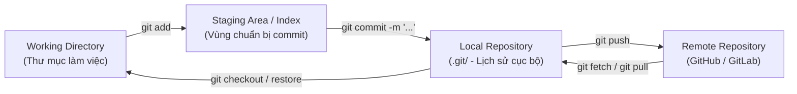

# Phần 1.5: Git, GitHub và Quy trình Submit Bài tập

## 1. Git là gì? Tại sao cần Version Control?

**Git** là một **Hệ thống quản lý phiên bản phân tán (Distributed Version Control System – DVCS)** do Linus Torvalds tạo ra năm 2005.
- **Quản lý lịch sử:** Ghi lại toàn bộ thay đổi mã nguồn theo thời gian dưới dạng các **snapshot (commit)** có mã băm định danh duy nhất (SHA-1/SHA-256).
- **Làm việc nhóm song song:** Cho phép nhiều lập trình viên phát triển tính năng trên các nhánh (**branch**) độc lập rồi hợp nhất (**merge**) lại.
- **Phân tán:** Mỗi máy lập trình viên lưu trọn vẹn lịch sử repository cục bộ — vẫn commit, xem log, tạo branch được khi mất mạng.

### 1.1. Bốn vùng trạng thái trong Git



### 1.2. Khái niệm `.gitignore`
Tệp `.gitignore` liệt kê các đường dẫn không nên đưa vào lịch sử Git, nhằm tránh:
- Đưa file nặng không cần thiết lên repo (`.venv/`, `node_modules/`, `*.qcow2`, `*.iso`, `*.db`).
- Lộ thông tin nhạy cảm (`.env`, API keys, mật khẩu database, khóa bí mật `*.pem`, `*.key`).
- File rác của hệ điều hành / IDE (`.DS_Store`, `__pycache__/`, `.vscode/`).

---

## 2. Các lệnh Git cốt lõi cần nắm vững

### 2.1. Khởi tạo & Cấu hình lần đầu
```bash
git config --global user.name "Ten Cua Ban"
git config --global user.email "email@example.com"
git config --global init.defaultBranch main

git init                        # Tạo repo Git mới ở thư mục hiện tại
git clone <url>                 # Tải một repo từ GitHub về máy
```

### 2.2. Chu trình làm việc hằng ngày
```bash
git status                      # Xem trạng thái file đã sửa / staged / untracked
git diff                        # Xem thay đổi chưa add vào staging
git add <file>                  # Đưa 1 file vào Staging Area (hoặc: git add .)
git commit -m "docs: ..."       # Tạo snapshot mới trong Local Repo
git log --oneline --graph --all # Xem cây lịch sử commit trực quan
```

### 2.3. Branch & Merge (Làm việc theo nhánh)
```bash
git branch                      # Liệt kê nhánh hiện có
git switch -c feat/sql-demo     # Tạo nhánh mới và chuyển sang nhánh đó
# ... chỉnh sửa, git add, git commit ...
git switch main                 # Quay lại nhánh chính
git merge feat/sql-demo         # Hợp nhất nhánh feat/sql-demo vào main
git branch -d feat/sql-demo     # Xóa nhánh sau khi merge xong
```

> **Khi xảy ra Merge Conflict:** Git đánh dấu đoạn xung đột bằng `<<<<<<< HEAD`, `=======`, `>>>>>>> branch-name`. Bạn mở file, chọn/sửa lại nội dung đúng, xóa các dòng đánh dấu đó, rồi chạy `git add <file>` và `git commit` để hoàn tất merge.

### 2.4. Hoàn tác thay đổi (Undo)
- `git restore <file>`: Hủy thay đổi chưa `git add` trong Working Directory.
- `git restore --staged <file>`: Bỏ file khỏi Staging Area (giữ nguyên sửa đổi trên đĩa).
- `git revert <commit-hash>`: Tạo một **commit mới** đảo ngược thay đổi của commit cũ — **an toàn tuyệt đối** khi đã `push` lên nhánh chung.
- `git reset --soft HEAD~1`: Lùi lại 1 commit nhưng giữ thay đổi trong Staging (chỉ dùng cho commit chưa `push`).

---

## 3. GitHub & Quy trình Cộng tác (GitHub Flow)

**Git** là công cụ dòng lệnh chạy trên máy; **GitHub** là nền tảng lưu trữ từ xa (Remote Hosting) xây dựng quanh Git, bổ sung:
- Giao diện quản lý mã nguồn, **Issues** (theo dõi lỗi/công việc), **Pull Request – PR** (đề xuất gộp nhánh và review code).
- **GitHub Actions** (CI/CD tự động chạy test/lint khi push).

### 3.1. Xác thực kết nối máy cá nhân với GitHub
Có 2 cách phổ biến:
1. **SSH Key (Khuyên dùng trên Linux/macOS):**
   ```bash
   ssh-keygen -t ed25519 -C "your_email@example.com"
   cat ~/.ssh/id_ed25519.pub     # Copy public key dán vào GitHub -> Settings -> SSH Keys
   ssh -T git@github.com         # Kiểm tra kết nối thành công
   ```
2. **HTTPS + Personal Access Token (PAT) hoặc GitHub CLI (`gh auth login`):**
   Lưu ý GitHub không còn cho dùng mật khẩu tài khoản khi `git push` qua HTTPS mà phải dùng PAT.

### 3.2. Quy ước viết Commit Message rõ ràng (Conventional Commits)
- `feat: ...` — Thêm tính năng / bài demo mới
- `docs: ...` — Viết hoặc cập nhật báo cáo, README, tài liệu
- `fix: ...` — Sửa lỗi code / SQL / script
- `chore: ...` — Cấu hình `.gitignore`, dọn dẹp cấu trúc repo

---

## 4. Hướng dẫn Submit Bài tập (chính Repository này) lên GitHub

### Bước 1: Kiểm tra trước khi đẩy lên Remote
Đứng tại thư mục gốc của repo (`tt_thud/`), chạy các lệnh sau để rà soát:
```bash
git status                      # Đảm bảo working tree sạch, không còn file tạm/lộ mật khẩu
git log --oneline --graph       # Kiểm tra lịch sử commit rõ ràng
```

### Bước 2: Tạo Repository trống trên GitHub
1. Đăng nhập GitHub -> nhấn **+** -> **New repository**.
2. Đặt tên repo (ví dụ: `tt_thud-report` hoặc `thuc-tap-ung-dung-lab01`).
3. **Không** tích chọn *Add a README file* hoặc *.gitignore* (vì repo local đã có sẵn).

### Bước 3: Liên kết Remote và Push lên GitHub
Thay `<username>` và `<repo-name>` bằng tài khoản của bạn:

```bash
# Nếu dùng SSH (khuyên dùng vì máy đã có khóa ~/.ssh/id_ed25519):
git remote add origin git@github.com:<username>/<repo-name>.git

# Hoặc nếu dùng HTTPS:
# git remote add origin https://github.com/<username>/<repo-name>.git

git remote -v                   # Kiểm tra lại URL remote
git push -u origin main         # Đẩy nhánh main và thiết lập tracking
```

### Bước 4: Gắn Tag mốc nộp bài (Tùy chọn, chuyên nghiệp)
```bash
git tag -a v1.0-submission -m "Hoan thanh bao cao Phan 1 va Phan 2"
git push origin v1.0-submission
```

### Bước 5: Quy trình nộp khi giảng viên yêu cầu Pull Request (nếu fork từ repo lớp)
1. **Fork** repository gốc của môn học về tài khoản GitHub cá nhân.
2. Clone bản fork về máy, tạo nhánh mới `git switch -c submission/23001573`.
3. Thêm bài làm vào thư mục quy định -> `git add` -> `git commit` -> `git push -u origin submission/23001573`.
4. Vào GitHub nhấn **Compare & pull request**, điền tiêu đề + mô tả ngắn gọn kết quả đạt được -> **Create pull request**.

Xem thêm checklist kiểm tra nộp bài tại [submissions/SUBMISSION_CHECKLIST.md](../submissions/SUBMISSION_CHECKLIST.md).
